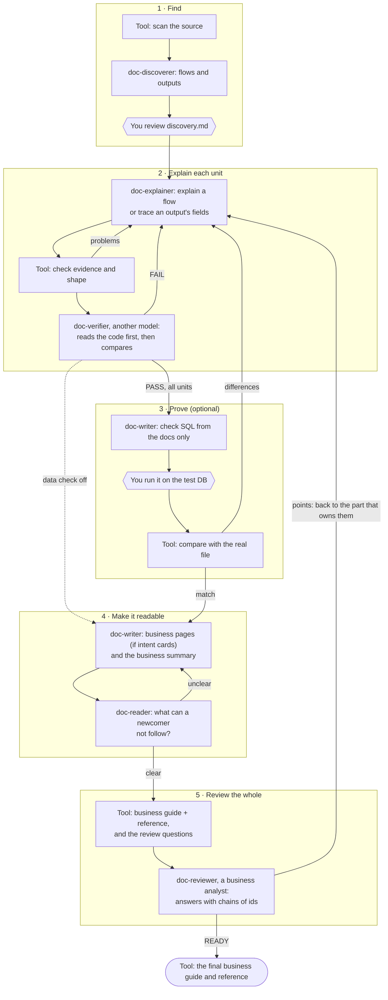

# Documentation kit

Turns the source code of a legacy module into **business logic documentation** that someone new to the business
can read and another team can build from: a business summary in plain words, the flows (what starts work, its
steps, scenarios and business rules), the outputs field by field where a specification exists, a glossary, and the
evidence and check status of every statement.

It runs in **GitHub Copilot Chat (agent mode)**. Markdown files tell the AI what to do; a small Python tool
(standard library only, nothing to install) does the exact work, which saves tokens and removes guesswork.

---

## How it works

A run has five phases. Each unit (one flow, or up to 12 output fields) goes round the same loop until it passes.



The reader also reads each flow once it passes (phase 2) and sends unclear parts back to the explainer.
Phase 3 runs only with `Data check: yes` in `module.md`; business pages only when `doc-input/concepts/` has intent
cards.

| Agent | Reads the code? | Does | Step files |
|---|---|---|---|
| `doc-discoverer` | yes | Lists the flows and outputs from the tool's inventory | `1-discoverer` |
| `doc-explainer` | yes | Explains one flow, or traces one output's fields | `2-explainer-flow`, `2-explainer-output` |
| `doc-verifier` | yes, on a different model | Writes its own reading first, then checks the unit | `2-verifier` |
| `doc-writer` | **no**, checked docs only | Check SQL, business pages, business summary | `3-writer-check-sql`, `4-writer-concept`, `4-writer-summary` |
| `doc-reader` | **no**, glossary only | Reads each part as someone new to the business | `4-reader` |
| `doc-reviewer` | **no**, the finished documents only | Reads the whole as a business analyst: can each question be connected to its rule, scenario and field? | `5-reviewer` |

Agents are split only by what they may read and which model runs them: an agent that has seen the code cannot
check whether the documentation is complete without it.

| Who | Does | Why |
|---|---|---|
| **AI** (6 agents, markdown steps) | Reads code and writes meaning: flows, rules, field lineage, the summary; checks another agent's meaning; reads it as a newcomer and as a business analyst | Needs understanding |
| **Python tool** | Scans, plans, keeps state, gives each agent only the context its unit needs, checks every quote against the file, checks that every decision line and term is covered, checks graphs and positions, compares files, checks walkthrough values against the real file, merges repeated questions, checks the reviewer's chains, assembles the documents | Must be complete, exact and the same every time; costs no tokens |
| **You** | Give business context, review the discovery and its explanation plan, run one SQL, answer SME questions | The code does not hold business meaning |

The controller (`/doc-run`) only runs `doc.py next` and starts the agent it names, so its own context stays
small. The state is in files: stop at any moment and run `/doc-run` again to continue.

## The result: two documents, each fact once

| Document | For | Holds |
|---|---|---|
| `<Name>-business-guide.md` | Business analysts, SMEs, newcomers | The business summary; one page per business question (✅/⚠️/❓ against what the business expects, the types and how each works, the fields the question changes, worked examples followed into the real file); the review; the open questions; the glossary |
| `<Name>-reference.md` | SMEs and developers who need the evidence | The flows with their rules and scenarios, every field of every output, the data check, readability, and the traceability of every id to its lines of code |

- **Each fact is explained once.** A rule lives in its flow, a field in its output section, a meaning in the
  glossary. The guide names the id and links into the reference instead of explaining it again. A business page
  lists only the fields its question changes (every variant field), not the whole file.
- **Each question once.** The tool rejects a question another part already asks, and the guide lists every
  question once, with every part that raised it.
- **Walkthroughs on real data.** A worked example ends with `**In the file:** O01 line 7` and the field values of
  that line; the tool reads the real test file and checks every value. That is how a reader connects a business
  case to the record it becomes.
- **A review that connects the dots.** The tool sets the questions (every difference, every type, the variant
  fields and a sample of others, the main example). The reviewer answers each with a chain of ids
  (`O01-16 → F01-BR09 → F01-SC3 → SUMMARY 6`) and the tool checks every link. Each point goes back to the part
  that owns it, at most twice; points still open keep the documents a DRAFT.

## Context and tokens

- The controller runs one command and starts one agent per unit; each agent starts with a clean context.
- `doc.py context <unit>` gives an agent only what its unit needs (the code it reaches, its SQL, decision lines,
  fields and rules), instead of the whole inventory.
- The writer and the reviewer read checked files and `doc.py lookup` results, never the code.
- A question asked or removed does not make the data check old: only a change to the facts asks you to run the
  SQL again.

## What makes it accurate

1. **Complete inventory of a Java backend.** The tool indexes the Java code (classes, methods, constants, enums,
   calls) and lists every entry point with **what it reaches** (methods and SQL), every SQL (in XML, in Java
   strings, built with `+` or `append`, stored procedure calls, SQL files), every comparison with a code
   (literal, constant resolved to its value, enum, number) and every setting (secrets hidden). The AI never has
   to search and miss things.
2. **Small units.** One flow, or at most 12 output fields, per agent call.
3. **Evidence checked by the tool.** Every rule quotes `path:line`; the tool opens the file and confirms the quote
   is there, and says on which line it really is when it is not.
4. **Shape checked by the tool.** The flow graph (every arrow followed by a scenario, every rule linked), ids,
   word limits, field positions against the spec, and the length of every example.
5. **Independent second reader** on a different model, which writes its own reading before it looks.
6. **Data check.** SQL written from the documentation alone rebuilds the output; the tool compares it with the real
   file and names the field and line of every difference.
7. **Rules linked to fields.** Every field requirement names the flow business rule it carries out
   (`O02-09-R1 → F01-BR05 Refund amount split`). The tool rejects a field with no rule, a rule id that does not
   exist, and a rule that writes an output but decides none of its fields. The document shows the map both ways.
8. **Every decision line is covered.** The scan lists every line that decides something in the code each flow
   reaches (if, switch, ternary, catch, throw, comparisons; WHERE, AND, CASE in SQL). The flow must cite each one
   as evidence of a rule, or say under "Decision lines not in a rule" why it is not one (it decides an output
   field, or it is technical). Every code value compared there (GOLD, COD) must appear in a rule or scenario.
   `doc.py conditions F01` shows the list and what is covered.
9. **Every scenario reaches the summary.** A flow has no limit on scenarios, and the business summary must name
   every scenario of every flow.
10. **Meaning only from your input, for every term.** Codes and business words come from `doc-input/`. Every code
    or abbreviation the documentation writes in capitals must have its meaning there, or a question for the SME.
    The glossary of the document is built from `glossary.csv` and the code tables in `business/`, and lists the
    terms still without a meaning.
11. **Rules that live in data are found.** Every table the documented flows only read (a mapping, a parameter
    table) and every stored procedure they call that is not in the source folders must be listed in discovery
    with what it decides and where its content is: `input`, a file in `doc-input/` with its exported rows, or a
    question. The tool checks every one.
12. **Calls the scan cannot follow are accounted for.** A call through an interface, a parent class or
    reflection is listed for the flow; the flow follows it into a rule or says where it leads. The tool checks
    every one.
13. **What the test data proves is measured.** For every business rule: proven by data (the rebuilt output
    matched the real file on every field it decides, in every case of their decision tables), partly shown, or
    read from the code only. The business guide says how many, and lists every case the test data never
    contains, so you know which records to add.
14. **The second reader spot-checks fields.** For each output unit the tool picks up to 3 fields (variant fields
    first) that the verifier traces from the code before reading the unit; the tool compares the business rules.
15. **Large flows are split or kept on purpose.** A flow that reaches more code than one agent reads well stops
    discovery until it is split by business step, or kept whole with a reason you review.

## Easy to follow for someone new to the business

1. **A plan for explaining it, reviewed by you.** Section 8 of `discovery.md` says who reads the document, the
   order to read the flows in (the order of the business process), the one example to follow from start to end,
   the terms to explain first and the cases to show.
2. **A business summary at the start.** Written from the checked files only, following that plan: the module in
   one paragraph, who is involved, the process step by step, the main example with real numbers, what can go
   wrong, and the words to know. The tool checks that every flow and scenario is in it, every term has a meaning
   from your input, and there is no code in it. The second reader checks it like any other unit.
3. **Plain words, checked.** The tool rejects Java names, method calls and code operators in the business text
   of flows, concepts and the summary.
4. **A reader who knows nothing of the business.** The agent `doc-reader` reads each flow, concept page and the
   summary with only the glossary at hand, retells it in its own words, and lists every point it cannot follow:
   a word without a meaning, a step that jumps, an example it cannot work out. The writer rewrites those points in
   plainer words (at most twice), and the second reader checks the facts again.
5. **Measured, not claimed.** The section "How easy it is to read" shows, per part, the unclear points at each
   reading, what is still unclear, and the sentence lengths.

## Business questions (concepts)

When the business asks "what is a refund, and how is each field derived?", free-form
prompts give a different, long and partly wrong answer each time. Instead, the business team writes an **intent
card** per question in `doc-input/concepts/` (see its README): what they expect, line by line, before the run.

With cards, the run changes in four ways:

1. **Scope.** Only the flows and outputs the concepts need are documented, end to end. The discovery must still
   place every entry point and every changed table (the tool checks it), so nothing is skipped silently.
2. **Order.** Flows and outputs first, each checked by the tool, a second reader and the data check. Then the
   `doc-writer` writes one business page per concept **from those checked files only, without the
   code**. That is why two runs give the same answer.
3. **The business page.** Each card line gets ✅ matches, ⚠️ differs or ❓ not found in the code, with the rule ids
   it rests on (the tool rejects ids that do not exist). Then each type and how it works, the fields the question
   changes, and worked examples from the test run, each followed into its line of the real file. The tool checks that every code the flows act on has a type row, that every variant field has a row,
   that each example's values match the real line, and that there is no code in
   the text.
4. **The business guide** opens with a business view: the gaps between the business intention and the system, then
   the business pages. The flow and field detail is in the reference, as the evidence behind them.

## How business rules connect to fields in the document

A flow's business rules (`F01-BR05 Refund amount split`) say what the system decides. An output's field sections
(`TAX_AMT`) say what is written. Each field requirement names the rule it carries out, and the document uses those
links in four places:

| Where | What you see |
|---|---|
| Section "Business rules and the fields they decide" | One row per rule, with every field it decides, grouped by output |
| Each rule in a flow | **Decides the fields:** links to those fields |
| Each field, and the field matrix | **Decided by:** the rules, by id and name |
| A business page's "Fields this question changes" table | A column with the business rules behind each field |

Every id in the document is a link to its rule or field; point at a rule id to see its title.

## Asking questions after the run (skill ask-the-docs)

When the document exists, anyone can ask Copilot Chat in their own words: "what happens when a customer returns
one item?", "how is TAX_AMT derived?", "which rule decides SHIP_METHOD?". The skill `ask-the-docs` makes Copilot
answer from the finished, checked document only, never from the source code, so the same question always gets the
same answer, with the rule ids it rests on and whether the document is FINAL or DRAFT.

Copilot finds the parts with `python .github/doc-kit/tools/doc.py lookup <ids, field names or words>`: ids
(`F01-BR05`, `O02-09`, `C01-I3`, `F01-SC2`) go straight to their place, words find the best matching rules and
fields. When nothing matches, the answer says so and suggests an intent card line or an SME question instead of
guessing.

## Set it up

1. From this kit's folder, install it into the repository that holds the code:
   `python .github/doc-kit/tools/doc.py install <path to that repository>`.
   Run the same command again to update a project to the current kit, so every project runs the same standard
   kit; add `--check` to only see what is out of date. It replaces only the kit's own files (the `doc-*` agents,
   `/doc-run`, the `ask-the-docs` skill, `.github/doc-kit/`, a marked block in `copilot-instructions.md`), backs up
   everything it replaces or removes in `.doc-kit-backup/`, adds only missing `doc-input/` templates, and never
   touches `doc-output/`.
2. Python 3.8 or newer must be on the path (`python --version`).
3. VS Code, Copilot Chat in **Agent** mode, with prompt files, custom agents and agent skills enabled in Settings.
4. In `.github/agents/*.agent.md`, set the `model:` lines: the strongest model for the discoverer, explainer,
   writer and reviewer, a **different** model for the verifier, and any model for the reader (a smaller one reads
   more like a newcomer).

## Run it

1. Fill in `doc-input/module.md` and put whatever business context you have in `doc-input/business/`: in new
   files, or at the end of `business/README.md` below its marked line. A table of codes and terms with their
   meaning is the most useful. Put a CSV specification in `doc-input/outputs/` for each output file that has a
   layout.
2. In Copilot Chat: `/doc-run`.
3. It stops when it needs you:
   - **Review `discovery.md`**: are the flows and outputs right, and is the plan in section 8 the way a newcomer
     should learn this business? Set its Status to REVIEWED.
   - **Data check** (when `Data check` is `yes`): run the SQL it wrote on the test database, save the result and the
     real file in `doc-input/test-data/<output id>/`.
   - **Finished**: read `doc-output/<Name>/<Name>-business-guide.md`; its links lead to the evidence in
     `<Name>-reference.md`. Answer the SME questions in
     `doc-input/sme-answers.md` and run `/doc-run` again: each answer goes to every part that asked that
     question, which is rewritten with it and checked again.

Useful commands (from the workspace root):

| Command | What it does |
|---|---|
| `python .github/doc-kit/tools/doc.py next` | The next step (what `/doc-run` runs in a loop) |
| `python .github/doc-kit/tools/doc.py status` | Every unit with its check status and attempts |
| `python .github/doc-kit/tools/doc.py check F01` | Check one unit file, `SUMMARY`, `REVIEW`, or `discovery` |
| `python .github/doc-kit/tools/doc.py context F01` | Only what one unit needs (used by the explainer and verifier) |
| `python .github/doc-kit/tools/doc.py install <project>` | From the kit's folder: install or update the kit in a project (`--check` to only report) |
| `python .github/doc-kit/tools/doc.py conditions F01` | Every decision line in the code a flow reaches, and whether the flow covers it |
| `python .github/doc-kit/tools/doc.py scan` | Write the inventory again |
| `python .github/doc-kit/tools/doc.py retry F01` | For a person: give a unit marked SME (out of attempts) a new start |
| `python .github/doc-kit/tools/doc.py lookup TAX_AMT` | The parts of the finished document about an id, a field or some words (used by ask-the-docs) |

To redo a unit: delete its file in `flows/` or `outputs/` and run `/doc-run`. To start a module again: delete
`doc-output/<Name>/`.

## Files

```
.github/
  copilot-instructions.md        points every chat to the rules
  prompts/doc-run.prompt.md      /doc-run: the loop
  agents/                        6 agents, split by what they may read
  skills/ask-the-docs/SKILL.md   answers business questions from the finished document
  doc-kit/
    steps/                       one file per agent task, numbered by phase (0-rules.md applies to all)
    templates/                   the exact shape of each file an agent writes
    tools/doc.py                 the tool; dockit/ holds one module per job, tests/ its tests
doc-input/                       what your team knows: module.md, business/, concepts/, outputs/, test-data/
doc-output/<Name>/               written by the run
  inventory.md   discovery.md   summary.md   flows/   outputs/   concepts/   verify/   reader/   review/
  data-check/   work/
  <Name>-business-guide.md       the result for business readers
  <Name>-reference.md            the evidence behind it
```

| Tool module | Job |
|---|---|
| `project.py` | Module settings and every file path |
| `markdown.py` | Reading headings, sections and tables |
| `java_index.py` | Java classes, methods and line ranges, constants and enums, calls between methods |
| `scan.py` | Inventory: entry points and their reach, SQL, code tables, outputs, comparisons, settings |
| `discovery.py`, `plan.py` | The reviewed flows, outputs and concepts; the units and their attempts |
| `concept.py` | The intent cards of the business team |
| `evidence.py`, `flowgraph.py`, `checks.py` | Checks on what an agent wrote |
| `coverage.py` | The decision lines and code values each flow must cover |
| `terms.py` | Meanings of terms from the input folder; the codes a text uses |
| `readability.py` | The newcomer reader's verdict; sentence measures |
| `links.py` | The links between business rules and the fields they decide |
| `compare.py` | Data check, field by field |
| `document.py` | The final document |
| `workflow.py` | The next step |
| `lookup.py` | The parts of the finished document that answer a question |
| `cli.py` | Commands |

## Limits

- Built for Java backends: plain Java and JDBC, servlets and `web.xml`, timers and threads, batch `main`
  methods, Spring, SQL in XML, PL/SQL. The Java index is pattern based, not a compiler: calls through
  interfaces, reflection or wiring in XML can be missing from the reach lists, and the review of `discovery.md`
  is where you catch them. Other languages are listed as not read.
- Test folders (`test`, `tests`) and build output are skipped.
- The decision lines of a flow come from the Java methods and XML SQL it reaches. Lines inside stored procedures,
  and code the reach lists miss, are not listed: the explainer and the verifier still read them.
- The data check proves what the test data contains. The report names the fields and lines that differ; add test
  rows for cases that matter and are missing.
- The AI documents what the code does, including bugs. Behaviour that looks wrong becomes a question, not a fix.
- No real customer data in `doc-input/`, ever.
